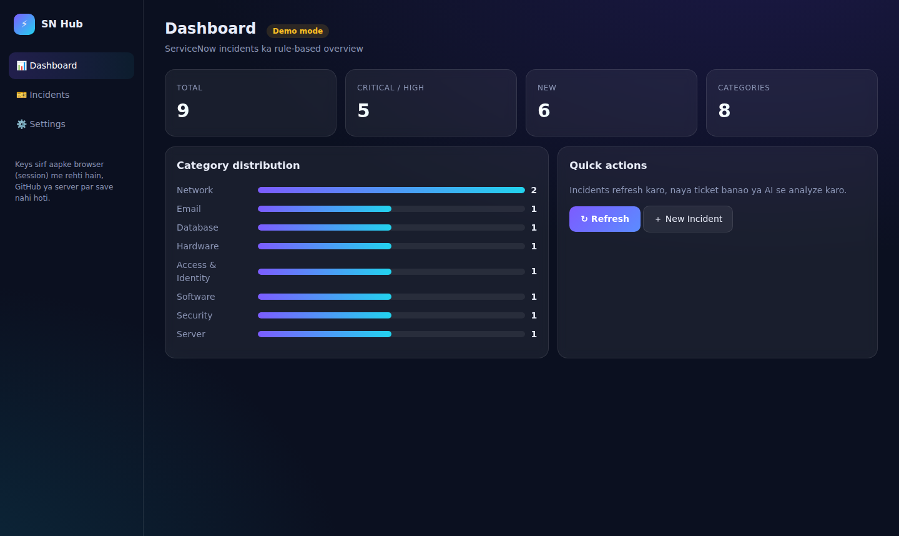
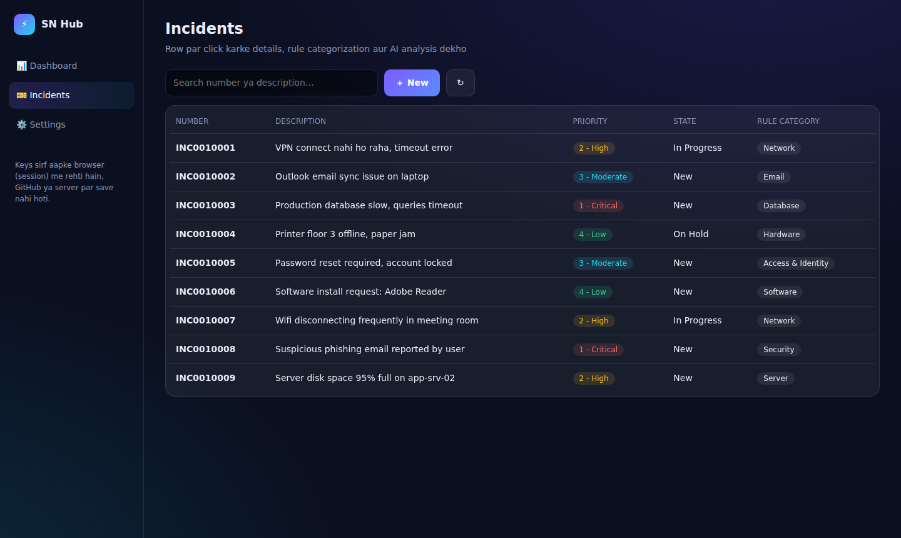
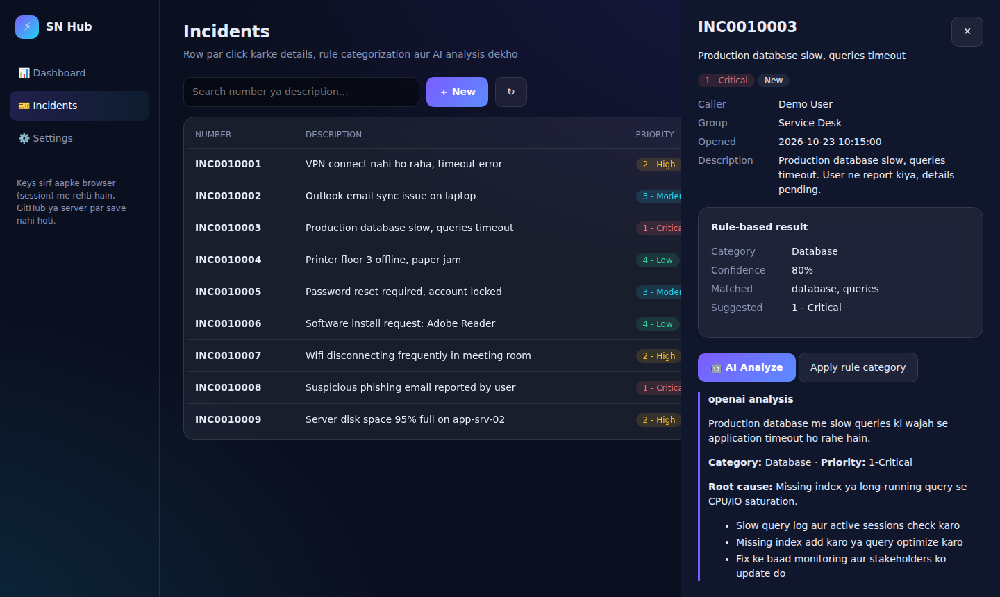
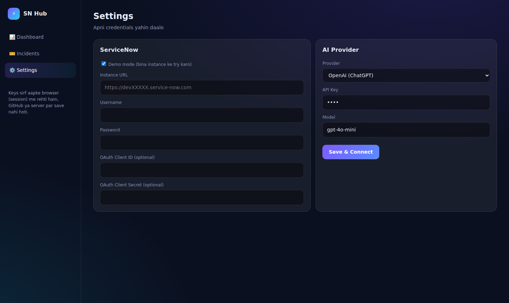
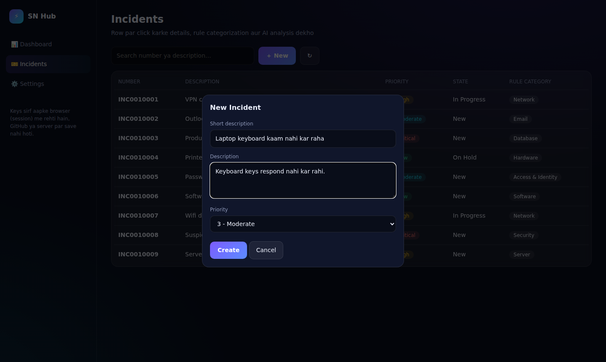

# ⚡ servicenow-python-integration

A Python + Flask application that talks to ServiceNow over its **REST API**, with an attractive web UI.
Fetch incidents, read ticket details, categorize them with rules, create/update tickets, and get AI analysis by entering your **OpenAI (ChatGPT), Anthropic (Claude) or Google Gemini** API key in the UI.

## Screenshots

| Dashboard | Incidents |
|---|---|
|  |  |

| Incident Detail + AI Analysis | Settings (ServiceNow + AI keys) |
|---|---|
|  |  |

**Create Incident**



> Note: The AI analysis screenshot shows a sample response (no real API key was used while capturing screenshots). With your own key, you will get the actual provider's response.

## Features

- 🎫 Incident list, search and details (ServiceNow Table API)
- 🏷️ Rule-based categorization (`app/categorizer.py`) with suggested priority
- ✍️ Create / update tickets (Basic Auth or OAuth)
- 🤖 AI analysis with **ChatGPT / Claude / Gemini**: choose a provider in the UI, enter your key and model
- 🧪 **Demo mode**: try the app without a ServiceNow instance
- ✅ `pytest` tests (ServiceNow client, OAuth, 3 LLM providers, API flow)

## Tech Stack

Python · Flask · requests · REST APIs · JSON · OAuth/Basic Auth · pytest

## Setup

Requires Python 3.9 or newer.

```bash
git clone https://github.com/<your-username>/servicenow-python-integration.git
cd servicenow-python-integration
python -m venv venv && source venv/bin/activate   # Windows: venv\Scripts\activate
pip install -r requirements.txt
python -m app.server
```

Open in your browser: **http://127.0.0.1:5000**

> On macOS (Monterey and later), port 5000 is used by AirPlay Receiver. Run `PORT=5001 python -m app.server` instead and open http://127.0.0.1:5001.

1. Open **Settings**. *Demo mode* is ON by default, so you can try the app right away.
2. For a live ServiceNow instance, turn Demo mode off and enter the Instance URL, Username and Password (OAuth is optional).
3. For AI, choose a provider, enter your API key, then click **Save & Connect**.

You can get a free ServiceNow **Personal Developer Instance (PDI)** at https://developer.servicenow.com. The user needs the `itil` role.

| Provider | Where to get a key | Default model (editable in the UI) |
|---|---|---|
| OpenAI | platform.openai.com | `gpt-4o-mini` |
| Anthropic | console.anthropic.com | `claude-sonnet-4-6` |
| Google Gemini | aistudio.google.com | `gemini-2.0-flash` |

## API Endpoints

| Method | Path | Purpose |
|---|---|---|
| POST | `/api/incidents/list` | List incidents with rule-based category |
| POST | `/api/incidents/create` | Create a new incident |
| POST | `/api/incidents/update` | Update an incident |
| POST | `/api/ai` | LLM analysis |

## Tests

```bash
pytest -q
```

## Regenerating the Screenshots

```bash
pip install playwright && playwright install chromium
python -m app.server &        # keep the server running
python docs/take_screenshots.py
```

## 🔒 Security

- Never upload API keys or passwords to GitHub. `.env` is listed in `.gitignore`; only `.env.example` is committed.
- Keys entered in the UI stay in the browser's `sessionStorage` and are sent to the backend with each request; the server does not save or log them.
- For production, run behind HTTPS and add login/authentication. This app is built for localhost use.

## Project Structure

```
app/            servicenow.py · categorizer.py · llm.py · server.py · static/index.html
tests/          test_all.py
docs/           screenshots/ · take_screenshots.py
```
